<p align="center"></p>

<h1 align="center">Quoteproof</h1>
<p align="center"><b>Research where every quote is checked against its source.</b></p>

---

AI research reports cite sources with confidence. The quotes are often paraphrased, misremembered or pinned to the wrong page, and asking the model to double-check means trusting the same model that made the mistake.

Quoteproof is an agent skill that checks with code instead. After researching, it fetches every cited page and matches each quote word for word.

## Try it free

**[Quoteproof Community](https://github.com/andre-arc/Quoteproof-Community)** is MIT licensed: the full 5-angle research pipeline with word-for-word quote checking on web pages.

```bash
git clone https://github.com/andre-arc/Quoteproof-Community.git ~/.claude/skills/quoteproof-community
```

Then ask your agent to research something. [Pro](https://www.agensi.io/r/ANDREARC?to=/skills/quoteproof&utm_source=github-core) adds PDFs and research papers, exact-text quoting and wrong-page detection; see the [comparison](https://github.com/andre-arc/Quoteproof-Community#community-vs-pro).

Tried it? **[Share a review](https://github.com/andre-arc/Quoteproof-Community/issues/new?template=review.yml)**: what you researched, the audit line, and what it caught or missed.

## How it works

<p align="center"></p>

1. **Decompose.** Splits your topic into 5 angles chosen for that topic.
2. **Search.** Researches the angles in parallel. Every claim is recorded as *claim → source URL → verbatim quote*.
3. **Verify.** Drops contradictions and marketing, then runs the bundled checker on every quote:
   | Result | Meaning | Action |
   | :-- | :-- | :-- |
   | `verified` | Quote is on the cited page (web page or PDF) | kept |
   | `misattributed` | Quote is real but on a different cited page | kept, source corrected |
   | `not_found` | Quote is on no fetched page | dropped |
   | `fetch_failed` | Page could not be loaded | kept only if confirmed manually |

   With Pro, an angle whose quotes fail too often is redone on your agent's strongest model (at most 2 per run). Research itself runs on the agent's fast, low-cost model, whichever vendor it comes from.
4. **Report.** A cited report: findings, recommendations, trade-offs and open questions, ending with an audit line of claims checked, verified, corrected and dropped.

## Use cases

**Technical decisions from primary docs.** Choosing a database mode, a protocol or a library, where the answer lives in official documentation and a misremembered detail costs you later.
> *"Research whether SQLite WAL mode is the right choice for concurrent writes in our app."*

Tested on exactly this: 78 quotes from the SQLite docs, one cited to the wrong page and corrected. Works in Community and Pro.

**Literature reviews and research-paper summaries.** Summarizing what papers actually found, where a quote that is *almost* right changes the meaning. Needs Pro, which reads PDFs.
> *"What does the research say about HTTP/3 versus HTTP/2 on lossy mobile networks?"*

In testing, Quoteproof caught two misquotes from research papers that the model had accepted, e.g. *"advantageous **for** users that move"* where the paper says *"advantageous **in case of** users that move."*

**Vendor and product comparisons.** Separating what vendors claim from what their docs and independent sources say. Every claim in the report links to a quote that exists on the cited page.
> *"Compare managed Postgres providers on backup guarantees and failover times."*

**Standards and specifications.** Questions answered by RFCs, W3C specs or API references, where the exact wording is the point.
> *"What does the QUIC RFC say about connection migration?"*

**Auditing AI-written research.** Already have a report from another AI tool? Ask your agent to list its quotes with their source URLs as a claims file, then run the bundled checker on it. We did this to Claude's deep research and found a paraphrase presented as a direct quote ([details](proof/vs-deep-research/README.md)).

### Not a good fit

- **Sources behind a login or paywall**, or pages that need JavaScript to show their text: they can't be fetched, so their quotes can't be checked.
- **Your own local files or pasted text:** sources must be public URLs.
- **Judging whether a claim is true:** Quoteproof proves the quote is on the page, not that the page is right.
- **Questions with no written sources**, such as opinions, predictions or brand-new events.

## Proof

<p align="center"></p>

<p align="center"></p>

<p align="center"></p>

<p align="center"></p>

<p align="center"></p>

| Test | Result |
| :-- | :-- |
| Real research run (78 claims, 14 pages) | 77 verified, **1 wrong-page citation caught and corrected** |
| HTTP/3 case study (83 claims, 35 from research PDFs) | 82 verified; an earlier run **caught 2 real misquotes** from papers |
| Stress test with 35 planted errors + 10 controls | **45/45** classified correctly |
| Same topic vs Claude deep research | **~28% of the research tokens**, on a cheaper model. 0 quote errors in the report vs 1 in deep research's |

Deep research covered the topic more broadly; see the [comparison](proof/vs-deep-research/README.md) for what each found. Full data, method and limits: [proof/](proof/README.md).

## Compared with prompt-only research skills

| | Prompt-only "verify your sources" skills | Quoteproof |
| :-- | :-- | :-- |
| Who checks the quote | The same model that wrote it | A script that fetches the page |
| Wrong page cited | Caught only if the model notices | Detected, with the right page named |
| Web access | Often relies on the host | Searches and fetches itself |
| Audit trail | Prose | Per-claim status in JSON |

## Compatibility

| | Status |
| :-- | :-- |
| **Python** | 3.9 – 3.14, tested on each. 3.8 and older do not work. Standard library only. |
| **Claude Code** | Tested end to end (Linux). The skill loads automatically from `~/.claude/skills/`. |
| **Other SKILL.md agents** (Cursor, Codex CLI, Gemini CLI, Windsurf, OpenCode, etc.) | Should work, not yet tested. The agent must be able to **run shell commands**, **search the web** and **write files**. |
| **Parallel research** | Uses subagents where the agent supports them. Agents without subagents research the 5 angles one after another: same result, slower. |
| **Chat apps with a sandbox** (e.g. claude.ai) | Limited. Sandboxes often block outbound network, so the script cannot fetch sources; the agent then checks quotes itself, which is less reliable. |
| **Operating system** | Linux tested. macOS should work (`brew install poppler` for PDFs). Windows untested; the command may be `python` or `py` instead of `python3`. |
| **PDF sources** | Need `pdftotext` (poppler-utils, recommended) or `pypdf`. Without either, PDF quotes are marked unchecked, never verified. Web pages work regardless. |
| **Sources it cannot check** | Pages that need a login or JavaScript to show their text, and sites that block automated requests (seen: Uber's blog). These come back `fetch_failed`; the agent confirms them by hand or drops them. |
| **Network** | Outbound HTTPS to the cited sites. Private and local addresses are refused. |

## Limitations

- Checks that a quote **exists** on its page, not that it **supports** the claim.
- PDF sources need `pdftotext` (poppler-utils, recommended) or `pypdf` installed; without them, PDF quotes are reported as unchecked, never as verified.
- Needs Python 3.9+ for the checker; without it, the agent checks quotes itself.
- Fetches the cited source URLs, so it needs network access.
- Sources must be public web pages or PDFs. It can't use your local files, pasted text or the conversation itself as sources, and it can't check quotes from them.

## Get it

**[Get Quoteproof on Agensi →](https://www.agensi.io/r/ANDREARC?to=/skills/quoteproof&utm_source=github-core)**

Tested with Claude Code; other agents that support `SKILL.md` skills and can run shell commands should work (see Compatibility above).

What's changed: [CHANGELOG](CHANGELOG.md).

---

<sub>© 2026 andre-arc. Logo and brand assets: all rights reserved. Proof data in `proof/` may be reused with attribution. [Quoteproof Community](https://github.com/andre-arc/Quoteproof-Community) is MIT licensed.</sub>
